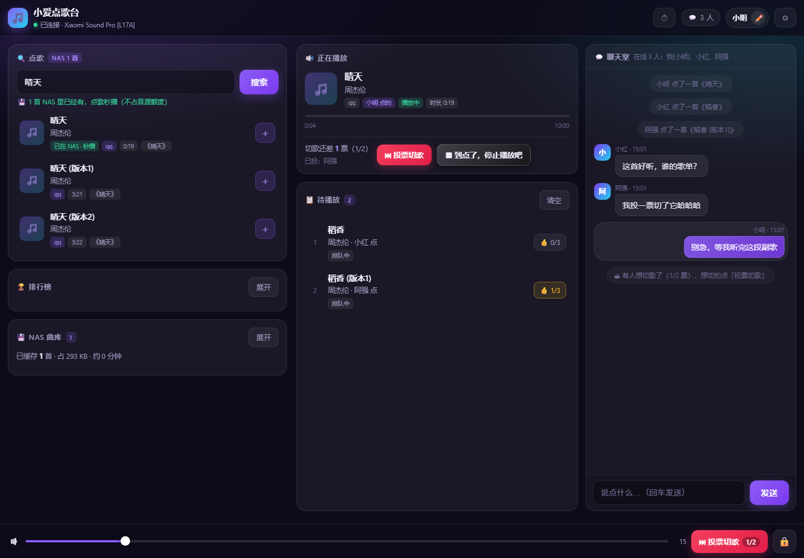
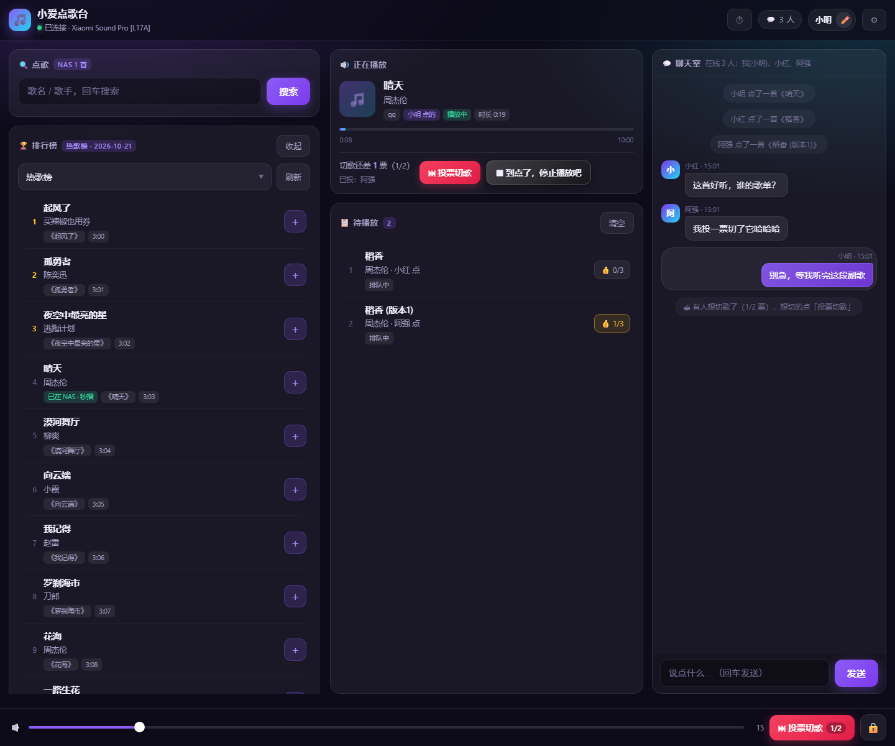
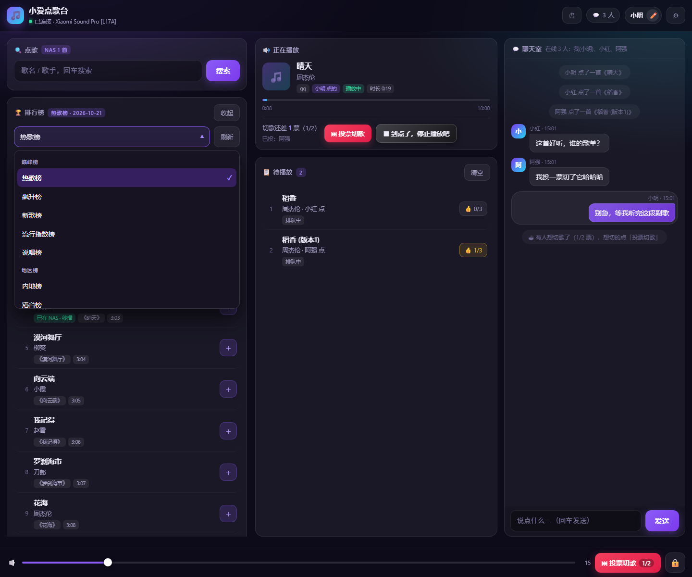
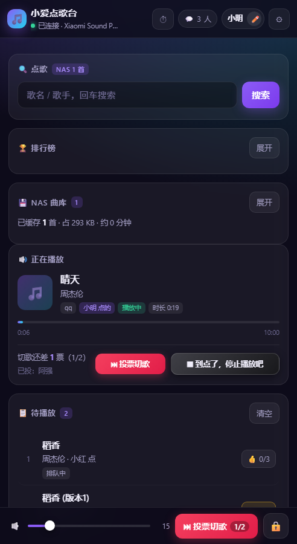

# 小爱点歌台 · XiaoAI Jukebox

> **办公室和家里的共享点歌台**：谁想听歌，手机打开网页点一首，小爱音箱接着放。
> 零 npm 依赖——后端一个 Node 文件，前端一个 HTML 页面，一台常开的小机器就能跑。

[](https://nodejs.org/)
[]()
[](LICENSE)

<p align="center">
  
</p>

---

## 为什么会有这个东西

一台音箱，一群人，两种场景——**办公室**和**家**。痛点一模一样：

- 音箱名义上是"公共设备"，实际控制权在**某一台手机**上，谁拿着手机谁说了算；
- 想听歌得走过去、连蓝牙、翻歌单，再走回来；
- 有人想切歌不好意思开口，有人一直在切别人又不好拦；
- 下班忘了关、沙发上睡着了忘了关，音箱能响一整夜。

点歌台只做一件事：**把控制权从"那台手机"搬到网页上**——一台音箱，多少人同时点都行，切不切歌大家投票，到点自己安静下来。

## 两种场景，同一套东西

| | 🏢 办公室 | 🏠 家庭 |
|---|---|---|
| 谁在用 | 同部门 5~20 个同事，各坐各的工位 | 夫妻 / 父母 / 孩子，手机各拿各的 |
| 音箱在哪 | 公共区、茶水间、开放工位角落 | 客厅、厨房台面、儿童房 |
| 最痛的点 | 一个人连蓝牙霸占一下午；午休想安静却有人在放摇滚 | 老人不会用音乐 App；做饭两手油没法操作手机；孩子睡前要听故事 |
| 靠什么解决 | 投票切歌 + 3 人点赞插队 + 全员可用的停止 | 浏览器免安装 + 大字按钮 + 定时关闭 + 随机电台 |
| 一起用的人 | 十几个人同时开着页面，谁点的歌排到哪一目了然 | 三四个人，但经常是"一个人点、全家听" |

### 🏢 办公室的一天

- **09:30 开工**——有人点一首提神的，队列里已经躺着另外三个人点的歌，顺序看得见；
- **12:10 午休**——想睡觉的人发起投票切歌，**票数超过在线人数一半**才会切，个别人切不动；
- **14:00 提需求**——某首歌被反复点、总排在后面，**3 个不同的人**给它点 👍，往前挪一位，挪完票清零（防一个人刷）；
- **18:30 有人想提前走**——谁都按得动 **⏹ 停止**，不需要找管理员要口令；
- **22:00**——定时关闭自动静音，但**队列不清空**，明早开机还能接着听。

### 🏠 家里的一天

- **17:30 做饭**——手上有油，不用解锁找 App，客厅平板上点两下就行；
- **18:10 吃饭**——孩子想听儿歌，大人想听老歌，各自点各自的，系统按顺序放；
- **20:00 收拾**——队列播完了，**随机电台**自动从本地曲库接着放，不重复、不联网；
- **21:30 哄睡**——定时关闭设 30 分钟，到点静音，**不会把第二天要听的队列清掉**；
- **周末断网**——播过的歌都缓存在自己 NAS 上，照样能点、照样能放。

## 功能

| 模块 | 说明 | 谁最需要 |
|---|---|---|
| 搜歌点歌 | 搜歌名/歌手 → 点 `＋` 入队，自动排队 | 两边都要 |
| 本地曲库 | 播过的歌自动下载到 NAS，下次**秒播**，断网也能放 | 🏠 家里 |
| 正在播放 | 封面、歌名、来源、点歌人、进度条、时长，多端实时同步 | 两边都要 |
| 投票切歌 | **票数 > 在线人数一半**才切，个别意见切不动整场 | 🏢 办公室 |
| ⏹ 停止 | **所有人都能按**，不要口令；掐断当前 + 清空全场队列 + 按住电台，并在聊天室喊一声是谁按的 | 🏢 办公室 |
| 队列点赞前挪 | 每首歌一个 `👍 x/N`：**N 个不同的人**点赞才往前挪一位（默认 3 人），挪完清零；一人一票可撤 | 两边都要 |
| QQ 排行榜 | 30 个官方榜单（热歌/飙升/地区/主题/场景/风格/电台），一键点歌 | 两边都要 |
| 随机电台 | 队列播空后自动从本地曲库接着放，不重复、不联网 | 🏠 家里 |
| 定时关闭 | 5 分钟后 / 今晚 23:30 / 每天 23:30，到点静音但**不清队列** | 两边都要 |
| 聊天室 | 系统播报（谁点了什么、谁切了歌）+ 自由聊天 + 在线人数 | 🏢 办公室 |
| 昵称门禁 | 进门必须起一个唯一昵称（全场认人，不认浏览器），闲置 7 天自动释放 | 两边都要 |
| 曲库管理 | 删除单曲、重新扫描；所有下载都落在自己的机器上 | 🏠 家里 |

**为什么非要"昵称"和"投票"？**
办公室里最容易出现的两种破坏者是"一个人开三个标签页刷票"和"一个人连着切十首"。
所以：票只认**服务端认过的昵称**（不是浏览器 cookie，换标签页不涨票），切歌要**过半**，插队要**3 个不同的人**。

## 界面

上面那张是主界面：左边点歌和排行榜，中间正在播放 + 待播队列，右边聊天室。再看三张细节。

**排行榜**——QQ 音乐 30 个官方榜单，卡片可折叠（默认收起，不占屏）。榜单里的歌点 `＋` 直接入队，已经存到本地曲库的会标 **「已存 NAS · 秒播」**，点下去几秒就响，不占音源配额。



**选榜单**——自定义深色下拉面板，按分组排列（巅峰榜 / 地区榜 / 主题榜…）。没用原生 `<select>`，因为系统弹层在深色页面里是白底，几乎看不清字。



**手机**——窄屏自动变单列，按钮加大。音量、投票切歌、⏹ 停止都在拇指够得到的地方，老人小孩也能用。



> 截图里的歌曲、昵称、聊天内容都是本地 mock 数据，不是真实账号。


## 它是怎么跑的

```
  手机 / 电脑 / 平板浏览器（办公室十几个，或家里三四台）
        │  HTTP（局域网）
        ▼
  ┌───────────────┐        ┌──────────────────────┐        ┌────────────┐
  │  jukebox      │  HTTP  │  songloft            │  MIoT  │  小爱音箱   │
  │  (Node，本仓)  │ ─────► │  (智能音箱插件服务)    │ ─────► │ Sound Pro  │
  └───────┬───────┘        └──────────────────────┘        └────────────┘
          │
          ├──► QQ 音乐 / 网易云：搜索 + 取直链
          └──► 本地磁盘：缓存 mp3 / flac，下次直接放
```

本项目只做「网页 + 队列 + 调度 + 缓存」，真正的「让音箱出声」交给第三方播放引擎：

- **songloft**（推荐）——带「智能音箱 / MIoT」插件的播放服务，支持小爱音箱系列；
- **xiaomusic** ——更轻，但只支持部分型号（本项目保留了兼容适配）。

## 安装

整个安装三步：**起播放引擎 → 起点歌台 → 网页上连一次**。全程约 15 分钟，只有第一次需要。

### 准备清单

| 需要什么 | 说明 |
|---|---|
| 一台 7×24 开着的机器 | NAS、软路由、旧笔记本、迷你主机都行。装了 Docker，或者用 Node ≥ 18 裸跑 |
| 一台小爱音箱 | 已经在米家里能正常播放（Sound Pro 实测最稳，其它型号看播放引擎的支持列表） |
| 一个固定内网 IP | 建议在路由器里做 DHCP 保留，否则重启换 IP 后音箱就找不到点歌台了 |
| 手机 / 电脑 | 浏览器打开网页就能点歌，不用装任何 App |

> 两个端口：点歌台 **58092**、播放引擎 **58091**，都要在局域网内能访问。

### 第 1 步：起播放引擎（songloft）

点歌台自己不会控制音箱，"出声"这件事交给 songloft。新建一个目录，放一份 `docker-compose.yml`：

```yaml
services:
  songloft:
    image: songloft/songloft:latest
    container_name: songloft
    restart: always
    ports:
      - "58091:58091"
    environment:
      TZ: Asia/Shanghai
      LISTEN_PORT: "58091"
      ADMIN_USERNAME: admin
      ADMIN_PASSWORD: "换成你自己的强密码"    # 不设就是 admin/admin，务必改掉
      PUID: "1000"
      PGID: "1000"
    volumes:
      - ./songloft/music:/app/music
      - ./songloft/data:/app/data
```

```bash
docker compose up -d
```

起好后浏览器打开 `http://<内网IP>:58091`：

1. 用 `ADMIN_USERNAME` / `ADMIN_PASSWORD` 登录（首次登录先去改个强密码）；
2. 进「智能音箱 / MIoT」插件，登录你的**米家账号**；
3. 把音箱设成**受管设备**，点一下试听，确认真的能出声；
4. 顺手记下**音箱的 device_id**（形如 `xxxxxxxx-xxxx-xxxx-xxxx-xxxxxxxxxxxx`）。

> 找不到 device_id 也没关系——第 4 步留空，点歌台会自动挑一台在线的 Sound Pro。

### 第 2 步：下载点歌台

```bash
git clone https://github.com/ziyang89/xiaoai-jukebox.git
cd xiaoai-jukebox
```

不想用 git：在仓库页面点 **Code → Download ZIP**，解压一样能用。

### 第 3 步：启动点歌台

**方式 A：docker compose（推荐）**

```bash
cp .env.example .env
```

打开 `.env`，改这三行（其余保持默认）：

```ini
# 你机器的内网 IP —— 音箱必须能访问到这个地址
JB_PUBLIC_BASE=http://192.168.1.100:58092
# songloft 的地址
JB_ENGINE_BASE=http://192.168.1.100:58091
# 音箱 device_id；留空 = 自动挑一台在线的 Sound Pro
JB_ENGINE_DEVICE=
```

```bash
docker compose up -d          # 首次会构建镜像，一两分钟
docker compose logs -f        # 看到 listening on 58092 就起来了
```

**方式 B：直接裸跑 Node（零依赖，不用装任何包）**

```bash
cd jukebox
cp config.example.json config.json    # 改 publicBase / engine.base / engine.deviceId
JB_CONFIG=./config.json node server.js
```

> 想让开机自启：Docker 已经写了 `restart: always`；
> 裸跑就用 systemd（Linux）、群晖的「任务计划」、fnOS 的「开机启动」挂一条 `node server.js`。

**数据放哪**

| 目录 | 存什么 | 建议 |
|---|---|---|
| `data/music`（容器内 `/music`） | 下载下来的 mp3 / flac | 曲库会一直变大，NAS 上给个几十 GB 就够用很久 |
| `data/jukebox`（容器内 `/data`） | 昵称、聊天记录、曲库索引、QQ 凭据、管理员哈希 | **要备份的就是这个目录** |

### 第 4 步：网页上连一次（只有第一次）

浏览器打开 `http://<内网IP>:58092`。引擎还没配好时，页面左侧会出现 **⚙️ 连接播放引擎** 卡片，填四项：

| 字段 | 填什么 |
|---|---|
| songloft 地址 | `http://192.168.1.100:58091` |
| 账号 | 默认 `admin` |
| 密码 | 第 1 步设的 `ADMIN_PASSWORD` |
| 音箱 device_id | 可以留空（留空自动挑） |

点 **「保存并连接」**。它会拿新凭据**先探一次，通了才写盘**——密码写错也不会把已有配置弄坏。

> 密码只写给服务端，不回传页面、不进日志；落在 `<数据目录>/runtime-config.json`，重启不丢。
> 以后要改，点右上角 **⚙** 再填一次。

### 第 5 步：设管理员口令

右下角 **🔒** → 设置管理员口令。这个口令**只管四件事**：直接切歌、昵称占用管理、QQ 音源配置、随机电台开关。
普通点歌、投票、点赞、按停止，**都不需要口令**。

口令只存 `sha256(salt::pin)` 哈希、不下发；忘了就删掉 `<数据目录>/admin.json` 重新设。

### 第 6 步（可选）：接入 QQ 会员音源

不配也能用（走网易云公共源，有频率限制）。想让音质好、不吃公共配额：

1. 浏览器登录 [y.qq.com](https://y.qq.com)，F12 → Application → Cookies，复制 `qm_keyst` 的值；
2. 网页 → 🔒 → **🎵 QQ 会员音源**，填 `qm_keyst` 和 QQ 号，点「测试」；
3. 通过后默认 **320k**，会员等级够可以改 FLAC。

> 凭据只落在你的 `runtime-config.json`，不进代码、不进镜像、不进仓库。

### 装完自己验一遍

```bash
curl http://192.168.1.100:58092/api/health     # {"ok":true,...}
curl http://192.168.1.100:58092/api/state      # engine.ready 应为 true
```

页面上再确认三件事：

- [ ] 点一首歌，几十秒内音箱开始放（首次要下载，慢一点正常）
- [ ] 进度条在走，不是卡在 0:00
- [ ] 手机和电脑同时开着，队列和「正在播放」是同步的

更细的排障信息（判定依据、音源状态、最近日志）都在 `http://<内网IP>:58092/api/diag`，不用登机器看日志。

### 常见问题

| 现象 | 原因 | 怎么修 |
|---|---|---|
| 页面打不开 | 端口没映射 / 防火墙拦了 | `docker compose ps` 看端口；NAS 防火墙放行 58092 |
| 「保存并连接」提示连不上 | 地址写错或密码错 | 浏览器直接开 `http://IP:58091` 能不能登录；别填公网域名 |
| 连上了但音箱没声 | 音箱没设成受管设备 / device_id 不对 | 回 songloft 确认设备在线；把 device_id 清空再试 |
| 点了歌一直「排队中」 | 音源取链失败 | 看 `/api/diag`，`sources.qq.broken` 为 true 就是 QQ 凭据过期了 |
| 重启路由器后不能用了 | 机器 IP 变了 | 做 DHCP 保留，并同步改 `.env` 里两个 IP |
| 音量太大/太小 | 默认 15 | 底栏滑杆临时调；长期改 `JB_VOLUME`（办公室 20~30，家里 10~15） |
| 想放公网给朋友用 | — | **别这么做**，没有 HTTPS 也没有账号体系，等于把点歌台交给所有人 |

## 部署建议（按场景）

| | 🏢 办公室 | 🏠 家庭 |
|---|---|---|
| 跑在哪 | 内网一台常开的服务器 / 虚拟机 | NAS、软路由、电视盒子旁的小主机 |
| 音量 | 建议 `JB_VOLUME=20~30`（开放空间） | 建议 `JB_VOLUME=10~15`（客厅够听，不吵到邻居） |
| 定时关闭 | 建议固定每天 22:00（下班后自动安静） | 睡前临时设 30~60 分钟即可 |
| 管理员 | 谁来管口令？建议指定一个人，别几个人抢着改配置 | 家里一个人管就够 |
| 昵称 | 让大家用真名或工位名，方便认人、也防刷票 | 用称呼（爸爸/妈妈/奶奶）即可 |
| 曲库 | 缓存会一直长大，定期清理 `Music/` 里没人听的 | 缓存最有用：断网、限流都不怕 |

## 配置

完整示例见 [`jukebox/config.example.json`](jukebox/config.example.json)，常用项：

| 键 | 默认 | 说明 |
|---|---|---|
| `port` | 58092 | 网页端口 |
| `publicBase` | 自动探测 | **音箱能访问到的**本服务地址，写内网 IP |
| `engine.base` / `engine.deviceId` | — | 播放引擎地址与音箱 ID |
| `sources` / `searchSources` | `["qq","netease"]` | 音源顺序，配了 QQ 会自动排最前 |
| `volume` | 15 | 音量（0–100），`forceVolume` 开启时每首歌都拉回这个值 |
| `autoRadio` | true | 队列空了自动续播本地曲库 |
| `sleepMaxMin` | 720 | 定时关闭最长可设多少分钟 |
| `toplistTtlMin` | 30 | 榜单缓存时长 |
| `queueTopNeed` | 3 | 几个人点赞才能往前挪一位 |

所有键都能用环境变量覆盖（`JB_PORT` / `JB_VOLUME` / `JB_ENGINE_BASE` …）。

## 适合 / 不适合

**适合**

- 一个固定空间 + 一台小爱音箱 + 一群人长期共用（办公室、家）
- 有 NAS 或常开小机器，愿意花半小时折腾一次
- 想要"点歌无门槛、切歌有秩序"的氛围

**不适合**

- 酒吧 / 门店 / 活动场地这类**陌生人环境**——没有账号体系，谁进内网谁都能点
- 想直接暴露到公网给朋友用（见下方安全说明）
- 完全不想碰命令行的人（至少要能跑一条 `docker run`）

## 安全与隐私

- **凭据不写进代码、不进镜像**：QQ cookie、管理员口令只存在 `<dataDir>/runtime-config.json` 和 `admin.json` 里，都在你自己的磁盘上；
- **管理员口令只存哈希**：`sha256(salt::pin)`，服务端不下发、日志不打印；
- **不往外发数据**：没有账号体系、没有埋点、没有云服务，所有请求只在你家/公司局域网里；
- **只适合内网**：没有 HTTPS、没有多租户隔离，**请不要直接暴露到公网**；
- 办公室里请把它放在**可信内网**（员工网）而不是访客 WiFi。

## 已知限制

- 播放能力受限于播放引擎和音箱型号（小米 Sound Pro 实测最稳）；
- QQ 音源用的是非官方接口，随时可能失效——所以有本地缓存和网易云兜底；
- 网易云公共源有频率限制（5 分钟 50 次），批量点歌会排队重试；
- 进度条依赖音箱回报的状态，而那个状态**经常给假数据**（残留值、闪 0、残留值还会往前走），代码里做了挂钟校准兜住——详见 `jukebox/README.md`。

## 目录结构

```
jukebox/
  server.js              后端全部逻辑（零依赖，单文件）
  public/index.html      前端全部界面（单文件，无构建）
  config.example.json    配置模板
  Dockerfile
  tests/                 30 个自测脚本（含 mock 音箱 / mock 音源 / mock QQ）
  README.md              实现细节、踩坑记录、调试手册
tools/static-server.js   本地预览用的静态服务 + 反代
docs/screenshots/        README 里的界面截图（本地 mock 数据截的）
```

## 测试

不需要真音箱、也不需要真音源，全程 mock：

```bash
cd jukebox
node tests/smoke.js          # 基础链路
node tests/chat-vote.js      # 聊天室 + 投票切歌
node tests/toplist.js        # 排行榜
node tests/queue-top.js      # 点赞前挪
node tests/sleep-timer.js    # 定时关闭
```

还有一批真机只读验收脚本（`verify-nas-*.js`），改完代码直接对线上实例跑一遍，
用指纹 + 字节比对确认「新版真的上线了」。

## 许可

[MIT](LICENSE)。QQ 音乐、网易云、小爱音箱的相关权利归各自厂商所有；
本项目只做局域网内的个人使用，**不要用于商业用途或大规模抓取**。
